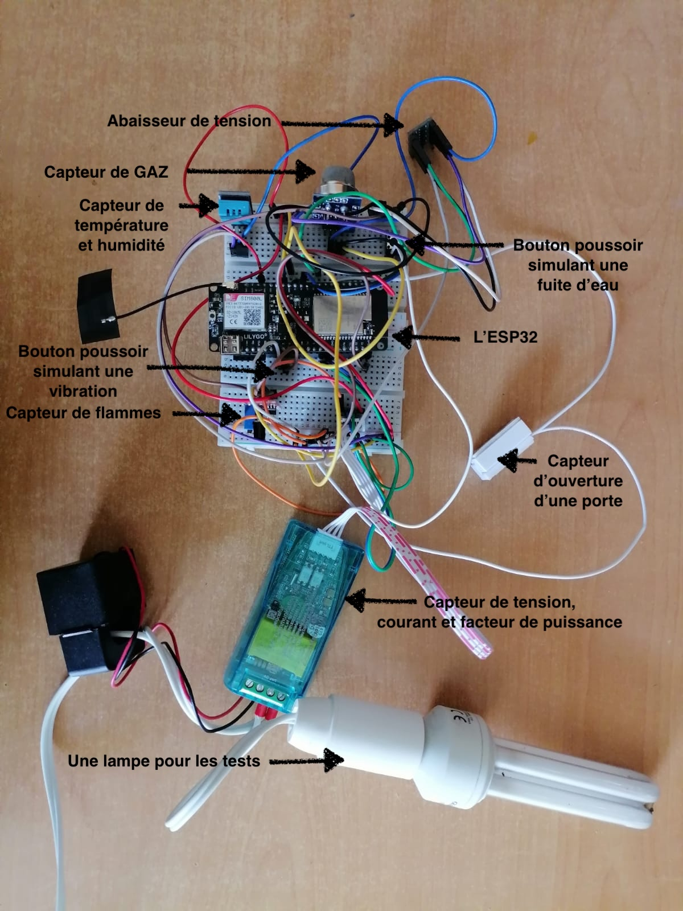
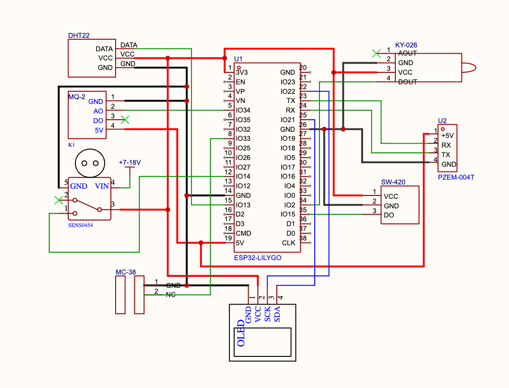
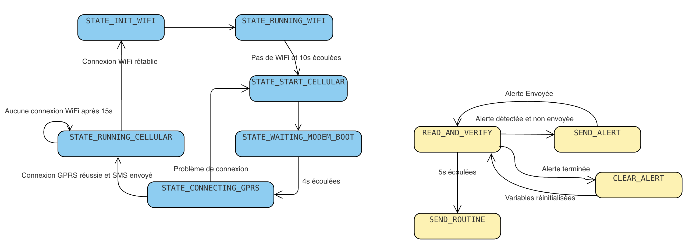

# ESP32 Data Center Monitoring Node

A low-cost, resilient IoT sensor node that monitors the electrical and environmental conditions of a server room, publishes data over **MQTT**, and keeps working when Wi-Fi or mains power fails.

## Features

- **Electrical monitoring**: voltage, current and power factor (PZEM-004T + split-core CT)
- **Environmental monitoring**: temperature and humidity
- **Safety alerts**: water leak, gas/smoke, flame, vibration, door opening, over-temperature, high humidity, over-voltage/over-current, mains power cut
- **MQTT publishing**: JSON telemetry every 5 s, alert and end-of-alert messages on a dedicated topic
- **Automatic Wi-Fi → GSM/GPRS failover** (SIM800L) and automatic return to Wi-Fi
- **Emergency SMS** on mains power cut and Wi-Fi loss
- **Local OLED display** (SH1106) with telemetry, network status and alert icons
- **Non-blocking firmware** built on two finite state machines (no `delay()` in the main flow)

## Hardware

| Component | Role |
|---|---|
| LilyGO TTGO T-Call (ESP32-WROVER-B + SIM800L) | MCU, Wi-Fi, GSM/GPRS, SMS |
| PZEM-004T + split-core CT | Voltage, current, power factor (UART, 9600 baud) |
| DHT11 (DHT22 planned) | Temperature and humidity |
| MQ-135 | Gas / smoke (analog, through a level shifter) |
| KY-026 | Flame detection |
| MC-38 | Door opening (magnetic switch) |
| SW-420 | Vibration |
| SEN0454 | Water leak |
| OLED SH1106 128x64 (I2C) | Local display |

> **Prototype notes:** due to supply constraints, the DHT22 was replaced by a DHT11, and the SW-420 (vibration) and SEN0454 (water leak) were simulated with push buttons. Code and alert logic are the same.

### Wiring

The MQ-135 outputs up to 5 V, so its analog signal goes through a level shifter before reaching the ESP32 ADC. The OLED uses I2C on GPIO 21 (SDA) and GPIO 22 (SCL), powered at 3.3 V.

## Software architecture

Two independent state machines run in `loop()`, driven by `millis()`:

- **Network_FSM**: `INIT_WIFI → RUNNING_WIFI → START_CELLULAR → WAITING_MODEM_BOOT → CONNECTING_GPRS → RUNNING_CELLULAR`. After 10 s without Wi-Fi it powers the modem and switches to GPRS. While on cellular it checks Wi-Fi every 15 s and switches back when available.
- **Sensors_FSM**: `READ_AND_VERIFY → SEND_ALERT / CLEAR_ALERT / SEND_ROUTINE`. Safety sensors are read every 200 ms, electrical/environmental ones every 2 s. Active alerts are stored in a 16-bit mask and changes are detected with a XOR against the already-reported alerts, so alerts stay independent.

## MQTT topics

| Topic | Content |
|---|---|
| `telemetry/routine` | `{"V":212.30,"A":0.12,"PF":0.41,"T":37.40,"H":37.00}` |
| `alerts/critical` | e.g. `INONDATION / EAU`, `FIN ALERTE : PLUS D'EAU` |

The prototype was tested with the public broker `broker.emqx.io` (no authentication). Use your own broker with TLS and credentials for any real deployment.

## Results

- All alerts triggered and cleared correctly, including simultaneous ones (door + water leak)
- Wi-Fi/GSM failover and return validated, with SMS notifications
- Flash usage 75 %, SRAM usage 14 %
- Prototype cost about 235 TND (roughly 70 €)

## Documentation

Full internship report (in French): [`docs/Rapport_Stage_CCNS.pdf`](docs/Rapport_Stage_CCNS.pdf)

## Author

**Nerimen Sahli**, Electrical Engineering student at ENIT
[GitHub](https://github.com/NerimenSahli)
